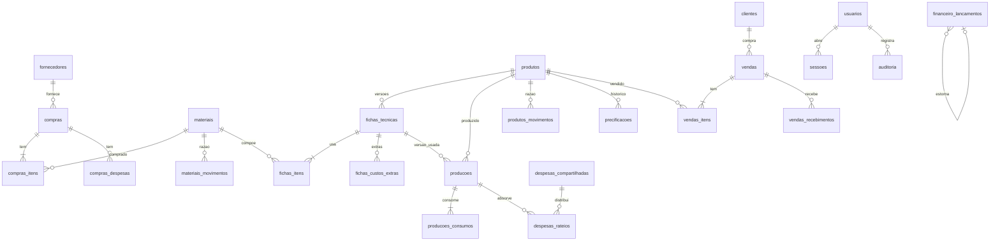

# Modelo de dados

SQLite em arquivo único (`flor-de-pitanga.db`), modo WAL, `foreign_keys = ON`, `synchronous = FULL`. Schema em `apps/api/src/db/migrations/` (`0001_inicial`, `0002_indices`, `0003_dados_base`) — migration aplicada nunca é editada (checksum). Fotos ficam fora do banco, em `dados/fotos/<uuid>.webp`.

**Convenções.** Todas as tabelas têm `id INTEGER PRIMARY KEY AUTOINCREMENT` e `criado_em`; as editáveis, `atualizado_em`. Datas de negócio em ISO `AAAA-MM-DD`. Dinheiro: totais em **centavos**, unitários em **micro-reais**, quantidades em **mili-unidades**, percentuais em **centésimos de ponto percentual**. Nada é apagado: registros têm `ativo`/`status` e cancelamentos geram estorno. Exceção: uma categoria pode ser removida depois de seus itens irem para outra, com nome, destino e itens movidos na auditoria.

## Diagrama

## Dicionário (resumo)

| Tabela                                                    | Papel e colunas-chave                                                                                                                                                                                                                                                                              |
| --------------------------------------------------------- | -------------------------------------------------------------------------------------------------------------------------------------------------------------------------------------------------------------------------------------------------------------------------------------------------- |
| `categorias`, `unidades`, `taxas`, `configuracoes`        | Apoio. `unidades(codigo, base, fator)`: `l → ml ×1000`, `kg → g ×1000`, `cx → un` (fator informado na compra). `taxas`: percentual ou fixa, sobre preço ou custo. Configurações: `valor_hora_padrao`, `remunera_mao_obra_propria`, `permite_estoque_negativo`, `ultimo_backup_em`, `nome_empresa`. |
| `usuarios`, `sessoes`, `auditoria`, `idempotencia`        | Acesso (argon2, sessão por token com hash sha256), trilha de operações que mudam estoque/preço/financeiro, respostas guardadas por `Idempotency-Key`.                                                                                                                                              |
| `clientes`                                                | `nome`, `telefone`, `observacao`. "Consumidor não identificado" é `vendas.cliente_id = NULL`; total comprado é consulta derivada.                                                                                                                                                                  |
| `fornecedores`                                            | `nome_loja`, `contato`, `observacao`.                                                                                                                                                                                                                                                              |
| `materiais`                                               | `unidade` base (`un`, `ml`, `g`, `m`), `estoque_atual` e `custo_medio` (**cache** do razão), `estoque_minimo`.                                                                                                                                                                                     |
| `materiais_movimentos`                                    | Razão: `quantidade` sinalizada, `custo_unitario`, `custo_total` (centavos, mesmo sinal), `saldo_apos`, `custo_medio_apos`, `referencia_*`, `justificativa` (obrigatória no ajuste).                                                                                                                |
| `compras`, `compras_itens`, `compras_despesas`            | Compra com conversão (`quantidade_informada` × `fator_conversao` = `quantidade_base`), `despesa_rateada`, `custo_unitario_final`; despesas por tipo e critério de rateio.                                                                                                                          |
| `produtos`                                                | `preco_venda`, `custo_producao` (custo médio dos acabados), `estoque_atual`, `foto_arquivo`, `mao_obra_pendente_media`.                                                                                                                                                                            |
| `fichas_tecnicas`, `fichas_itens`, `fichas_custos_extras` | Ficha **versionada** (única por produto+versão; uma ativa por produto), rendimento, mão de obra por hora/fixa/nenhuma, itens em mili-unidades, extras por peça ou por lote.                                                                                                                        |
| `despesas_compartilhadas`, `despesas_rateios`             | Um só lançamento de caixa (`lancamento_id`); rateios por produto ou produção só para custeio; `producao_id` marca a produção que absorveu o rateio.                                                                                                                                                |
| `producoes`, `producoes_consumos`                         | Lote com custo **gerencial** e **de estoque** fotografados; `ficha_id` = versão usada; consumos com custo congelado.                                                                                                                                                                               |
| `produtos_movimentos`                                     | Razão dos acabados (mesma forma de `materiais_movimentos`).                                                                                                                                                                                                                                        |
| `precificacoes`                                           | Histórico de decisões de preço: modo, parâmetro, custo base, taxas, preço sugerido/final, lucro e margem.                                                                                                                                                                                          |
| `vendas`, `vendas_itens`, `vendas_recebimentos`           | Venda com `subtotal`, `desconto`, `total`, `cmv`, `lucro_estimado`; itens com custo e mão de obra congelados; recebimentos parciais.                                                                                                                                                               |
| `financeiro_lancamentos`                                  | Razão único: `tipo`, `natureza`, `valor` (sempre positivo), `data_competencia`, `data_caixa`, `afeta_resultado`, `afeta_caixa`, `status`, `referencia_*`, `estorna_lancamento_id`.                                                                                                                 |
| `backups`                                                 | Registro dos `.zip`: arquivo, tamanho, `hash_sha256`, integridade, origem (`manual`, `automatico`, `pre_migracao`, `pre_restauracao`).                                                                                                                                                             |

### Acréscimos em relação ao esboço do plano

`sessoes` e `idempotencia` (requisitos de login e `Idempotency-Key`); `despesas_rateios.producao_id`; `produtos.mao_obra_pendente_media` e `vendas_itens.mao_obra_unitaria` (linha opcional "lucro após remunerar o próprio trabalho").

## Invariantes (`npm run db:check`)

1. `materiais.estoque_atual` = soma dos movimentos. 2. Idem para `produtos`. 3. Nenhum estoque negativo sem autorização e justificativa. 4. `vendas.total` = `subtotal − desconto` = soma dos itens. 5. Recebimentos ≤ total. 6. Situação da venda coerente com os recebimentos. 7. Toda venda não cancelada tem uma receita e um CMV vigentes. 8. Compra de matéria-prima nunca afeta o resultado. 9. Soma dos rateios = valor da despesa. 10. Variação de caixa operacional + estoque + contas a receber = resultado.
